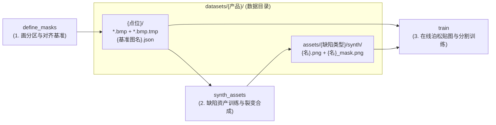

# `synth_assets` —— 工业缺陷数字资产合成实施方案

## 一、 项目定位：解决什么问题？

在工业视觉训练中，现场真实缺陷样本往往**数量极少（仅几张到几十张）**，且**人工逐个抠取缺陷素材（`{名}.png` + `{名}_mask.png`）耗时费力**。

`synth_assets` 的定位是 **“缺陷素材裂变兵工厂”**：
- **不改动现有训练架构**：不重复造“大图贴图”或“训练分割模型”的轮子；
- **输入**：直接读取 `datasets/{产品}/{点位}/` 下已有的真实图像（`.bmp`）、多边形标注（`.bmp.tmp`）与分区定义（`{基准图名}.json`）；
- **输出**：将少量真实缺陷自动裂变为数百对形态各异、光影逼真、带像素级精准掩码的 **`{名}.png` + `{名}_mask.png` 缺陷小图**，直接写入 `datasets/{产品}/assets/{缺陷类型}/synth/`，供 `train` 仓库零修改无缝调用。



---

## 二、 目录结构与文件格式规范

### 1. 全局配置文件原则（三仓统一遵守）

| 文件类型 | 扩展名 | 规则说明 | 典型文件 |
| :--- | :--- | :--- | :--- |
| **人工维护的配置** | **`.jsonc`** | 允许编写 `//` 与 `/* */` 注释，方便研发与现场人员维护说明 | `config/app_config.jsonc`<br>`datasets/{产品}/{点位}/assets.jsonc` |
| **代码生成的产物** | **`.json`** | 标准纯 JSON（无注释），所有字段含义统一在仓库 `README.md` 中说明 | `{基准图名}.json`（`define_masks` 产出）<br>`models/.../manifest.json`（`synth_assets` / `train` 产出） |

### 2. 全工程目录布局（正式产物进 `models/`，过程缓存进 `.tmp/`）

与 `train` 仓库保持完全一致的产物管理逻辑：
- **`models/{产品}/{缺陷类型}/`**：仅在 **Step 2 LoRA 训练成功结束时** 统一生成，存放训练好的 **LoRA 权重、形态模板库（`templates/`）与 `manifest.json`**（正式可复用资产）。以后想补造新一批素材时，无需重新训练，直接加载即可秒级生图；
- **`.tmp/{产品}/{缺陷类型}/`**：存放切图缓存、未完成训练前的候选形状模板（`1_crops/templates/`）、重绘过程图、验收预览图等**一切中间过程文件**，随时可整目录一键删除，绝不污染源码、`models/` 和 `datasets/`。

```text
supervised_apps/
 ├─ datasets/                                  # 【产品素材库 · 不进 GitLab】
 │   └─ {产品}/                                # 例如 HT12/ (一产品一闭环目录)
 │       ├─ assets/                            # 该产品专属缺陷素材库
 │       │   ├─ 砂眼/
 │       │   │   ├─ *.png + *_mask.png         #   人工收集的原始素材
 │       │   │   └─ synth/                     #   【synth_assets 最终产出】AI 合成素材配对
 │       │   └─ 划痕/
 │       │       ├─ *.png + *_mask.png
 │       │       └─ synth/
 │       └─ {点位}/                            # 例如 JXFB-1-P1/、JXFB-1-P5/
 │           ├─ {基准图名}.json                #   define_masks 产出的分区定义 (标准 JSON)
 │           ├─ assets.jsonc                   #   分区 × 资产绑定 (人工维护 JSONC, dir="../assets/...")
 │           └─ *.bmp (+ *.bmp.tmp)            #   原图与多边形标注 (label="砂眼"/"划痕"/"排除")
 │
 ├─ define_masks/                              # 【仓库 1：基准图分区定义与对齐实验】
 ├─ train/                                     # 【仓库 3：多点位缺陷分割训练】
 │
 └─ synth_assets/                              # 【仓库 2：缺陷数字资产合成流水线】
     ├─ config/
     │   └── app_config.jsonc                  # 全局配置 (人工维护 · JSONC)
     ├─ src/synth_assets/                      # 纯源码目录
     │   ├── step1_prep.py                     # 阶段 1：512 切片 + 轮廓外扩三区掩码 + 提取形状模板至 .tmp
     │   ├── step2_lora.py                     # 阶段 2：FLUX.1-Fill 软权重 LoRA 训练 + 成功后统一晋升至 models/
     │   ├── step3_inpaint.py                  # 阶段 3：模板弹性变形 + 局部重绘生成
     │   ├── step4_extract.py                  # 阶段 4：前后差分自动抠图 + 质量门控 + 小图导出
     │   └── main.py                           # CLI 统一编排入口
     │
     ├─ models/{产品}/{缺陷类型}/               # 【正式模型资产 · 仅在 Step 2 训练成功结束时写入】
     │   ├── lora_weights.safetensors          # 训练好的缺陷专属 FLUX LoRA 权重
     │   ├── manifest.json                     # 资产元数据 (代码生成 · 标准 JSON)
     │   └── templates/                        # 随 LoRA 训练成功一并转正的真实缺陷二值形态模板 (*.png)
     │
     └─ .tmp/{产品}/{缺陷类型}/                 # 【中间过程缓存 · gitignore · 随时可一键删除】
         ├── 1_crops/                          # 512×512 训练切片、三区权重掩码、切图预览拼图
         │   └── templates/                    # Step 1 提取的候选真实缺陷二值形态模板 (训练成功前暂存于此)
         ├── 2_inpaint/                        # 512×512 重绘前干净底图与重绘后对比缓存
         ├── 3_preview/                        # 差分抠图验收拼图 (原底图 | 生成图 | 差分热力 | 最终掩码)
         └── logs/                             # 运行日志
```

---

## 三、 全流程事件线树

```text
uv run synth --product HT12
 │
 ├─ Step 1. 样本切片与掩码准备 (step1_prep)
 │      ├─ 扫描 datasets/HT12/{各点位}/*.bmp.tmp，按具体缺陷名 (如 "砂眼"、"划痕"，跳过 "排除") 归类
 │      ├─ 轮廓外扩：顺着人工标注的多边形轮廓固定外扩 8px 作为过渡缓冲带
 │      ├─ 生成三区权重图：多边形内核心区 = 1.0 │ 外扩 8px 缓冲带 = 1.0→0.4 渐变 │ 外部背景区 = 0.0
 │      ├─ 固定 512×512 切块：以缺陷为中心 (含轻微随机偏移，避开同图其他缺陷) 原生 1:1 裁出 512×512 图块
 │      └─ 产物：训练切片、三区权重图与候选二值轮廓 templates/ 全部写入 .tmp/HT12/{缺陷类型}/1_crops/（此时不写 models/）
 │
 ├─ Step 2. 缺陷资产 LoRA 训练 (step2_lora)  [在双 A40 服务器执行]
 │      ├─ 加载 FLUX.1-Fill-dev (bfloat16 原生精度) + Step 1 的 512 图块与三区权重掩码
 │      ├─ 掩码加权损失：仅对核心区(1.0)与缓冲带(0.4~1.0)计算生成误差，外部背景(0.0)不计入损失
 │      └─ 产物（训练成功结束时原子化交付）：将 lora_weights.safetensors、.tmp/.../1_crops/templates/ 与 manifest.json 一并写入 models/HT12/{缺陷类型}/
 │
 ├─ Step 3. 掩码裂变与局部重绘 (step3_inpaint)  [在双 A40 服务器执行]
 │      ├─ 裁干净底图：在点位图的合法检测分区内 (避开已有 .tmp 标注区) 随机裁取 512×512 干净金属块 P_clean
 │      ├─ 捏新形状：抽取 models/HT12/{缺陷类型}/templates/ 中的真实缺陷轮廓 → 随机旋转/翻转/缩放 + 弹性扭曲变形 → 外扩 8px 得粗框 M_local
 │      ├─ AI 局部重绘：挂载该缺陷 LoRA，在 P_clean 的粗框 M_local 内画出新缺陷
 │      └─ 无损羽化回贴：粗框边缘向内 4px 余弦羽化融合，框外像素 100% 保持 P_clean 原样，得到 P_final
 │
 └─ Step 4. 前后差分自动抠图与导出 (step4_extract)
        ├─ 前后相减：计算 |P_final - P_clean| 的灰度差与纹理梯度差 (填成正常金属的地方差值≈0，真缺陷处差值极大)
        ├─ 底噪自适应卡线：测量框外正常金属底噪 σ，差值 > 3.5σ 定为缺陷核心，吸附周围 > 1.8σ 的相连边缘阴影，得精准掩码 M_GT
        ├─ 质量门控过滤：若抠出的缺陷面积过小或峰值信噪比 < 3.5，判定为“未成功画出缺陷”的废片，自动丢弃重画
        └─ 紧包裁剪落盘：按 M_GT 外接框 (+8px 边距) 裁出小图，写入 datasets/HT12/assets/{缺陷类型}/synth/{序号}.png + _mask.png
```

---

## 四、 核心操作说明：从 0 到 1 轮廓时间线 & 各阶段原理

### 0. 从 0 到 1：缺陷轮廓（Mask）全生命周期操作时间线（速查表）

从人工标注 `.tmp` 开始，直到进入 `train` 泊松融合贴图训练，缺陷轮廓经历了 **“紧贴标注 → 外扩留过渡带 → 差分收紧提纯 → 落盘留余量 → 内存抹平背景 → 外扩送入泊松 → 按原掩码柔边回写并打标签”** 的完整闭环：

| 时间线阶段 | 所在模块 | 对轮廓（Mask）与背景做了什么？ | 为什么要做这一步？（一句话抓重点） |
| :--- | :--- | :--- | :--- |
| **① 人工标注** | `define_masks`<br>标注 `.tmp` | 紧贴真实缺陷边缘画多边形（**不外扩 `0px`**） | 确立最原始的真实缺陷几何边界 $M_{\text{raw}}$。 |
| **② LoRA 切片** | `synth_assets`<br>Step 1 & 2 | 在 `512×512` 切片上拆成两份暂存 `.tmp/1_crops/`：<br>• 原多边形直接转二值图入 `.tmp/.../templates/`（**`0px`**，待 Step 2 训练成功后转正进 `models/`）；<br>• 训练权重图顺着轮廓**外扩 `+8px`**（核心 `1.0`，外扩环带 `1.0→0.4`，外部 `0`）。 | 存 `templates/` 是为了保留真实缺陷的原始骨架；训练权重外扩 `+8px` 是为了让 LoRA 学会缺陷边缘与周围金属的过渡衔接。 |
| **③ 合成重绘与裁剪落盘** | `synth_assets`<br>Step 3 & 4 | • **重绘前**：取 `models/.../templates/` 弹性变形后**外扩 `+8px`** 得粗框 $M_{\text{local}}$ 送给 AI 画缺陷；<br>• **重绘后**：前后相减（$|P_{\text{final}} - P_{\text{clean}}|$）按底噪倍数把掩码**收紧回真实长出的缺陷边缘 $M_{\text{GT}}$**（即 `*_mask.png`）；<br>• **裁小图落盘**：按 $M_{\text{GT}}$ 外接矩形**向外留 `+8px` 边距**裁出 `*.png` 与 `*_mask.png`。 | 重绘前扩 `+8px` 给 AI 留融合缓冲；重绘后差分收紧是为了剥离被 AI 填成正常金属的边框；裁小图留 `+8px` 边距是为了让 `*_mask.png` 四周留有一圈金属背景余量，供下游泊松外扩使用。 |
| **④ 训练加载与旋转** | `train`<br>`assets.py` + `dataset.py` | • **内存抹平背景**：读取小图配对进内存时，**先把 `~mask` 区域填平为外圈背景中值**，且若 `mask` 贴边则自动向四周补 `1px` 背景边；<br>• **随机缩放与旋转**：图像双线性插值，`mask` 经插值 + `1px` 高斯柔化得浮点掩码 `m_float`（`0~1`）。 | 先抹平 `~mask` 背景，防止把素材原图里的异物或条纹带进新底图；补 `1px` 边防止 `0~360°` 旋转时边界复制拉出三角伪影。 |
| **⑤ 泊松贴入与打标签** | `train`<br>`paste_poisson` | 1. **掩码外扩送泊松**：将 `m = (m_float > 0.4)` **外扩 `+5~7px`**（若贴边则自动补边），送入 `cv2.seamlessClone(NORMAL_CLONE)` 解泊松方程；<br>2. **原掩码柔边回写**：仅按未外扩的 **`m_float`（`1px` 柔边）** 将泊松调光后的缺陷软混合写回底图；<br>3. **打训练标签**：按未外扩的 **`m_float > 0.25`** 标为缺陷正样本 `1`。 | 1. OpenCV 泊松内部会强行向内腐蚀 `4px`，因此必须先外扩 `5~7px` 才能保住缺陷梯度不被吃掉；<br>2. 按未外扩的 `m_float` 回写，保证缺陷本体以外 **100% 不破坏底图原有纹理**；<br>3. 监督标签收紧回 `m_float > 0.25`，避免模型把外扩背景学成缺陷导致预测框发胖。 |
| **⑥ 底图已有真缺陷屏蔽** | `train`<br>`_annot_tile` | 底图 `.bmp.tmp` 上的真缺陷多边形向四周**外扩 `+4px`**（`ANN_DILATE = 4`），标为 `255`（忽略区，不计 Loss）。 | 人工标注紧贴缺陷，外扩 `+4px` 设为忽略区，防止紧挨标注框外侧的缺陷边缘过渡像素被当成正常背景 `0` 误导模型。 |

---

### 1. `synth_assets` 各阶段核心设计说明

| 阶段 | 关键操作 | 怎么做（具体动作） | 为什么这么做（设计目的） |
| :--- | :--- | :--- | :--- |
| **Step 1**<br>切图准备 | **顺着多边形轮廓外扩 `8px`** | 将 `.tmp` 中的缺陷轮廓多边形向四周形态学膨胀 `8px`，形成“内部核心区 + 8px 缓冲环带” | 人工标注通常贴着缺陷边缘（或略带几像素背景）。如果只让 AI 在原框内画画，AI 没空间画缺陷边缘的**立体暗影、毛刺或明暗过渡**，画出来像剪纸。顺着轮廓外扩 `8px` 给 AI 留出过渡带，且因为是顺着轮廓扩（非矩形框），长划痕也只是两侧加宽 `8px`，不会框入多余背景。 |
| **Step 1**<br>切图准备 | **统一固定 `512×512` 切片** | 所有训练与重绘统一按 `512×512`（1:1 原生像素，不缩放）裁剪 | 1. 保持 1:1 工业相机原生锐度，不因缩放模糊细微缺陷；<br>2. 避免多尺寸分桶导致训练 Batch 无法对齐和显存碎片化；<br>3. 与下游 `train` 仓库的切块尺度（`512`）完全一致。 |
| **Step 2**<br>LoRA 训练 | **三区软权重损失 + 成功后统一转正** | 核心区权重 `1.0`、外扩 8px 缓冲带权重 `1.0→0.4`、框外权重 `0.0`；仅当 LoRA 训练成功完成时，才把权重与 `.tmp/1_crops/templates/` 一起写入 `models/` | 1. 把框外权重设为 `0`，逼迫 AI **把 100% 算力用来学“缺陷长什么样”及“缓冲带怎么和周围金属衔接”**；<br>2. 训练未成功前 `models/` 目录保持绝对干净，只有训练成功结束才一次性产出完整可用的模型包（权重 + 形态模板 + 元数据）。 |
| **Step 3**<br>形态裂变 | **真实模板弹性变形（揉橡皮泥）** | 取真实缺陷轮廓做任意角度旋转、缩放，并叠加二维平滑随机位移场扭曲轮廓，再外扩 `8px` 作为重绘框 | 既保留了该类缺陷真实的物理形态规律（如砂眼的凹凸锯齿感、划痕的细长弧度），又保证生成的几百个新缺陷**没有两个形状完全雷同**。 |
| **Step 3**<br>局部重绘 | **合法分区采样 + 框外零篡改** | 只在点位 `{基准图名}.json` 允许的检测分区（如 `"加工面"`）内取干净底图，重绘后仅更新粗框内部像素 | 保证生成的缺陷底座纹理就是该产品真实待检面的材质纹理，且重绘框外 **100% 像素零改动**，为下一步“前后相减自动抠图”提供绝对干净的基准。 |
| **Step 4**<br>自动抠图 | **前后相减（差分提纯）** | 拿【画完缺陷的图 $P_{\text{final}}$】减去【画之前的干净底图 $P_{\text{clean}}$】 | 给 AI 重绘的是带缓冲带的宽框（例如 `20px` 宽），AI 在中间画了 `5px` 宽的真划痕，两边 `15px` 被 AI 补成了正常金属。前后相减后，**补成正常金属的地方差值接近 0，直接抵消归零；只有真正长出缺陷的那 5px 差值巨大**——从而无需人工抠图，全自动提纯出精准的 `_mask.png`。 |
| **Step 4**<br>自动抠图 | **按“背景底噪倍数”双阈值卡线** | 先算框外正常金属的底噪波动 $\sigma$；规定差值 $>3.5\sigma$ 为缺陷核心，再把核心旁 $>1.8\sigma$ 的相连像素吸纳进掩码 | 传统的 `Otsu（大津法）` 会强行把画面按比例分两半，遇到微小缺陷（如 `3×3` 小砂眼）会把整圈背景噪点误判为缺陷。按**背景底噪倍数**卡线，无论缺陷多大或多小，只要真画出来了就能精准抠出；若全框差值都未超过 $3.5\sigma$，还能自动识别为生成失败的废片并直接淘汰。 |
| **Step 4**<br>紧包导出 | **按精准掩码外接框（`+8px` 边距）裁成小图** | 在 `512×512` 上抠出精准掩码后，按掩码外接矩形（四周留 `8px` 边距）裁成小图存入 `assets/{类型}/synth/` | 下游 `train` 仓库需要紧包缺陷的小图配对；四周留 `8px` 边距与 `train` 泊松融合前外扩 `5~7px` 遥相呼应，确保外扩时有充足的背景余量。 |

---

## 五、 常用命令设计（与 `train` 保持一致的极简风格）

```bash
# 1. 一键跑完整流程（切图 → 训练 LoRA → 生成合成素材 → 差分抠图入库）
uv run synth --product HT12

# 2. 只针对某一种缺陷合成（如只跑“砂眼”，生成 200 个新素材）
uv run synth --product HT12 --defect 砂眼 --count 200

# 3. 已有训练好的 LoRA（在 models/HT12/砂眼/ 下），跳过训练直接裂变生成新素材
uv run synth --product HT12 --defect 砂眼 --skip_train --count 300

# 4. 仅运行 Step 1 切图预处理（可在开发笔记本上跑，检查 .tmp/HT12/砂眼/1_crops/ 下的切图预览与候选模板）
uv run synth --product HT12 --step prep
```

---

## 六、 代码生成 `.json` 与人工维护 `.jsonc` 格式定义

### 1. `config/app_config.jsonc`（人工维护 · 支持注释）

```jsonc
{
  // 切块与重绘分辨率 (固定 512×512, 1:1 原生像素不缩放)
  "tile_size": 512,
  // 缺陷多边形轮廓固定外扩像素数 (缓冲带宽度)
  "mask_dilate_px": 8,
  // 基座模型路径或 HuggingFace ID
  "base_model": "black-forest-labs/FLUX.1-Fill-dev",
  // LoRA 训练默认参数 (双 A40 bf16)
  "lora_rank": 32,
  "train_steps": 1000,
  "learning_rate": 1e-4,
  // 每类缺陷默认合成目标数量
  "synth_count": 200,
  // 差分抠图信噪比阈值: 核心区高阈值 / 边缘吸附低阈值
  "snr_high": 3.5,
  "snr_low": 1.8,
  // 导出小图四周保留边距 (供下游 train 泊松外扩 5~7px 使用)
  "export_pad_px": 8,
  "seed": 20260927
}
```

### 2. `models/{产品}/{缺陷类型}/manifest.json`（代码生成 · 标准 JSON）

```json
{
  "product": "HT12",
  "defect_class": "砂眼",
  "trigger_token": "[DEF_HT12_砂眼]",
  "tile_size": 512,
  "mask_dilate_px": 8,
  "num_real_samples": 38,
  "num_templates": 38,
  "lora_rank": 32,
  "train_steps": 1000,
  "area_stats": {
    "min": 120,
    "median": 650,
    "max": 3200
  }
}
```
